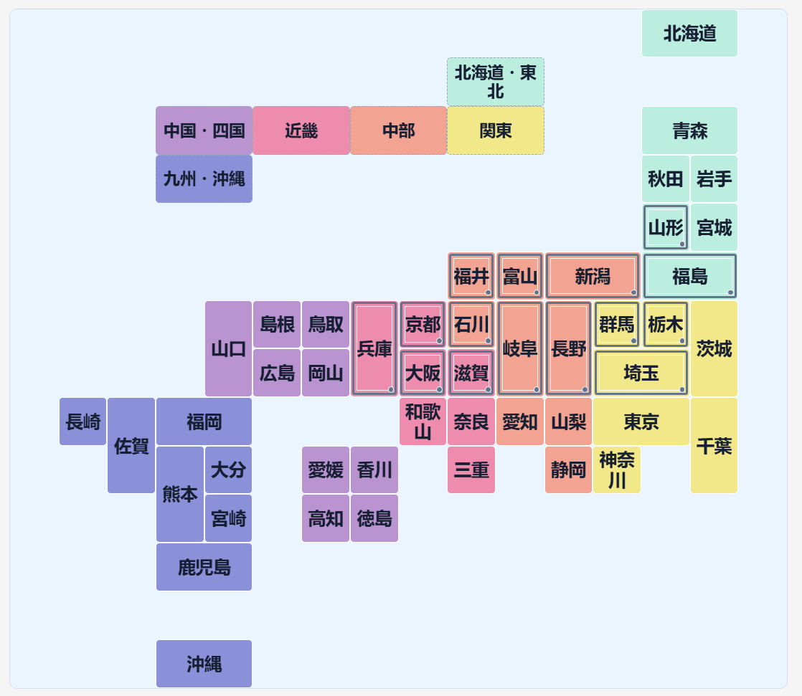

# map-styles

A [react-doc](https://github.com/wwf971/react-doc) package of maps drawn in styles of their own: **block maps**, grids of cells with blocks on them (rectangles and polygons, in groups), shown, selected in and edited in place, and kept as frontend objects; and on them the **selection of Japanese areas** (regions, prefectures and municipalities).

[](https://wwf971.github.io/map-styles/)

**Try it:** [wwf971.github.io/map-styles](https://wwf971.github.io/map-styles/), the doc page of the package, read-only: click a prefecture, click a region to take all of it, or drag a box.

The repository is the package: `doc-package.yaml` is its config, `doc/README.md` its root document. Launched as a doc page, it shows its documents and demonstrations, and its maps can be edited:

```sh
node <react-doc checkout>/main/frontend/cli/doc-cli.js dev <this folder> --port 45185
```

`npm test` runs the tests of the block maps (node with tsx).

`sh script-build/pages-deploy.sh` builds the page from what is committed and publishes it on the branch `gh-pages`.
